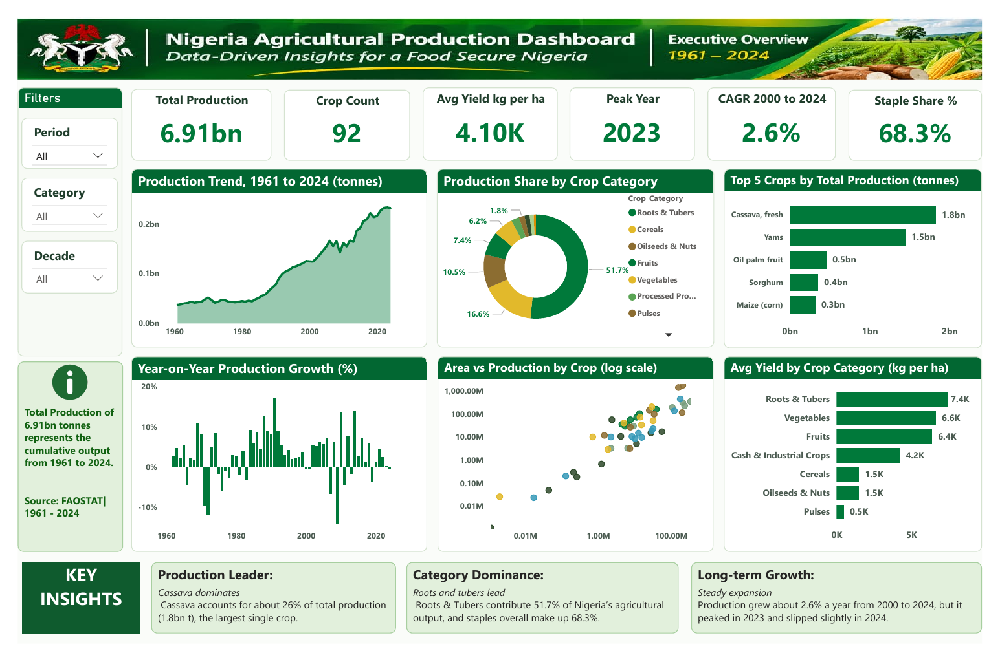
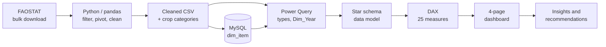
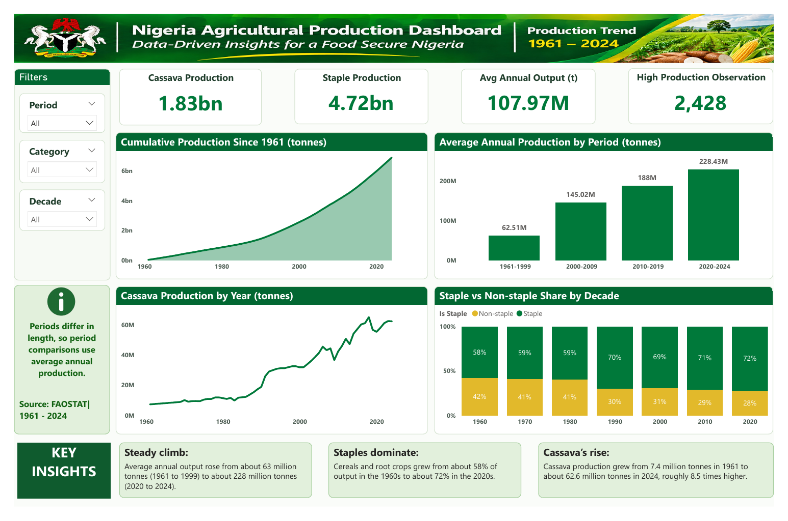
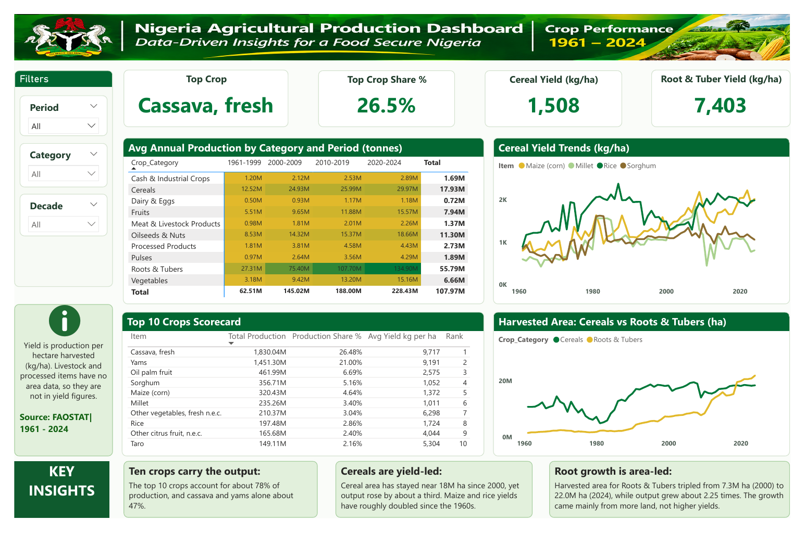
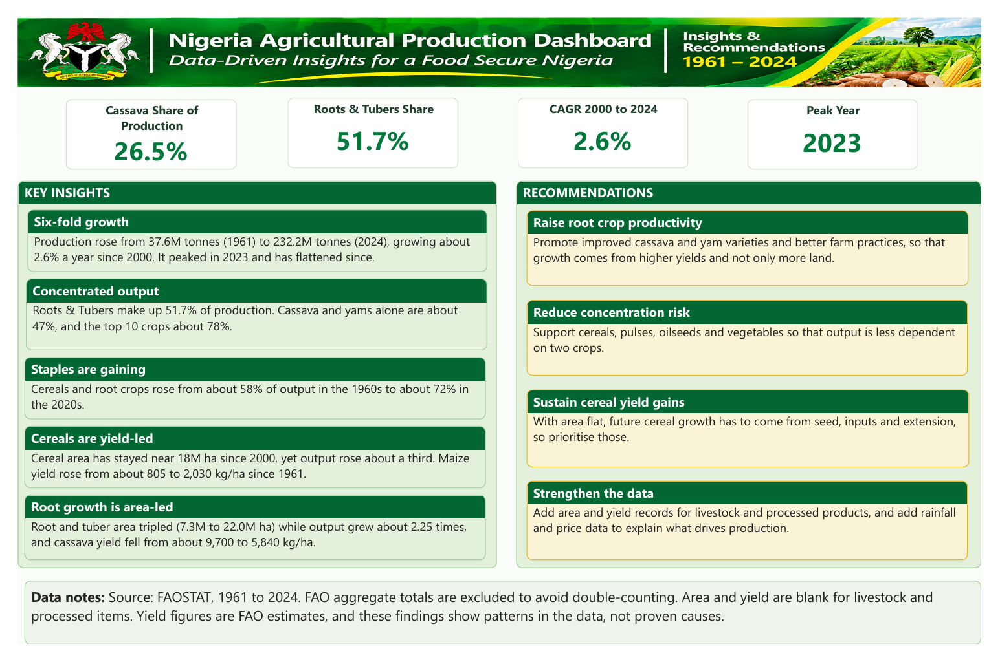

# Nigeria Agricultural Production Dashboard (1961 to 2024)

An interactive Power BI dashboard that turns 64 years of FAOSTAT crop and livestock statistics for Nigeria into clear insights on production trends, crop mix, yield and harvested area.



**Open the interactive report:** download [`powerbi/Nigeria_Agri_Dashboard.pbix`](powerbi/Nigeria_Agri_Dashboard.pbix) and open it in Power BI Desktop (free). A PDF export is in [`powerbi/Nigeria_Agri_Dashboard.pdf`](powerbi/Nigeria_Agri_Dashboard.pdf).

## Project workflow



## Key findings

- **Long-term growth:** production rose from about 37.6 million tonnes (1961) to 232.2 million tonnes (2024), growing about **2.6% a year from 2000 to 2024**. It peaked in 2023 (about 233.5 million tonnes) and was flat in 2024.
- **Concentrated output:** Roots & Tubers make up **51.7%** of production. Cassava alone is **26.5%**, cassava and yams together about **47%**, and the top 10 crops about **78%**.
- **Staples are gaining:** cereals and root crops together rose from about 58% of output in the 1960s to about 72% in the 2020s (68.3% over the whole period).
- **Cereal growth looks yield-led:** cereal harvested area has stayed near 18 million ha since 2000, yet output rose by about a third.
- **Root crop growth looks area-led:** harvested area for roots and tubers tripled (7.3 million ha in 2000 to 22.0 million ha in 2024) while output grew about 2.25 times, and cassava yield fell from about 9,700 to 5,840 kg/ha.

These are patterns in the data, not proven causes. Every number above is checked against the underlying data in [`docs/reconciliation.md`](docs/reconciliation.md).

## Dashboard pages

| Page | Focus |
|---|---|
| 1. Executive Overview | KPIs, production trend, category share, top 5 crops, YoY growth, area vs production, yield by category |
| 2. Production Trend | Cumulative production, average annual output by period, cassava trend, staple vs non-staple share by decade |
| 3. Crop Performance | Category by period matrix, top 10 crops scorecard, cereal yield trends, harvested area |
| 4. Insights & Recommendations | Five insights, four recommendations and data notes |

### Page previews

**Production Trend**



**Crop Performance**



**Insights & Recommendations**



## Skills demonstrated

- **Data acquisition:** downloading and extracting FAOSTAT bulk data with Python
- **Data cleaning and transformation:** pandas and Power Query (filtering, pivoting, type handling, missing values)
- **Exploratory data analysis:** statistics, correlations and Plotly charts in the notebook
- **SQL:** MySQL schema creation, data import and a database connection to Power BI
- **Data modelling:** star schema with fact and dimension tables and one-to-many relationships
- **DAX:** 25 measures, including time intelligence, ranking, CAGR and share-of-total logic
- **Data visualisation:** four themed report pages with slicers and interaction control
- **Agricultural data analysis:** production, area and yield relationships across crop categories
- **Business intelligence storytelling:** insights and recommendations linked to the data
- **Validation:** an independent script that recomputes every dashboard figure

## Data

- **Source:** [FAOSTAT](https://www.fao.org/faostat/en/#data/QCL), *Crops and livestock products*, Nigeria, 1961 to 2024 (production in tonnes, area harvested in ha, yield in kg/ha).
- **Size:** 6,504 rows across 108 items (92 crops and livestock products, plus 16 FAO aggregate totals).
- **Column definitions:** see the [data dictionary](docs/data_dictionary.md).
- **Method and limitations:** see the [methodology](docs/methodology.md).

### Data notes

- **FAO aggregate rows are excluded.** Rows such as "Cereals, primary" or "Meat, Total" already contain the items beneath them. Summing everything gives 13.3 billion tonnes, while the true total is 6.9 billion. The `Is_Aggregate` flag in `Dim_Item` is used in every measure.
- **Blanks are kept as blanks.** Area and yield are empty for livestock and processed products, which have no harvested area. They were not replaced with zeros.
- **Periods have different lengths** (1961-1999 is 39 years, 2020-2024 is 5), so period comparisons use average annual production.
- **Yield figures are FAO estimates** and can change between data releases.

## Data model

Star schema with `Fact_Production` in the centre:

```
Dim_Item (Item_ID, Item, Crop_Category, Is_Aggregate) 1 ---< Fact_Production >--- 1 Dim_Year (Year, Decade)
```

`Dim_Item` was imported from a local MySQL table ([`sql/Dim_Item_MySQL.sql`](sql/Dim_Item_MySQL.sql)). `Dim_Year` is generated in Power Query ([`powerquery/Dim_Year.pq`](powerquery/Dim_Year.pq)).

## DAX measures

25 measures and one calculated column, all in [`dax/measures.dax`](dax/measures.dax). The key calculations (aggregate exclusion, CAGR, cumulative production, production share and period averages) are explained in [`dax/README.md`](dax/README.md).

## Repository structure

```
.
├── data/
│   ├── processed/    cleaned dataset from the Python notebook
│   └── powerbi/      fact and dimension tables used in the model
├── notebooks/        FAOSTAT download, cleaning and analysis (Jupyter)
├── sql/              MySQL script for the Dim_Item table
├── powerquery/       Power Query (M) queries
├── dax/              DAX measures and explanations
├── powerbi/          the .pbix report and a PDF export
├── scripts/          verify_numbers.py recomputes the dashboard figures
├── docs/             data dictionary, methodology, reconciliation, workflow diagram
└── screenshots/      one image per dashboard page
```

## How to use

**Explore the dashboard:** open `powerbi/Nigeria_Agri_Dashboard.pbix` in Power BI Desktop. The data is already loaded, so no setup is needed. If Refresh fails, it is because `Dim_Item` came from a local MySQL database. Point that query at `data/powerbi/Dim_Item.csv` instead.

**Check the numbers:**
```
pip install pandas
python scripts/verify_numbers.py
```

**Rebuild from scratch:**
1. Run the notebook to download and clean the FAOSTAT data, or use the CSVs in `data/`.
2. (Optional) Run `sql/Dim_Item_MySQL.sql` in MySQL Workbench and import `Dim_Item.csv`.
3. In Power BI Desktop, load `Fact_Production.csv` and `Dim_Item.csv`, then create `Dim_Year` from `powerquery/Dim_Year.pq`.
4. Create the one-to-many relationships shown above.
5. Add the measures from `dax/measures.dax`.

## Tools

Python (pandas, Plotly), Power Query, MySQL, Power BI Desktop and DAX.

## Author

**Sarah Oko**, business and data analyst and agricultural economist, Abuja, Nigeria.
[LinkedIn](https://www.linkedin.com/in/sarah-oko-662305262) | [GitHub](https://github.com/Saraiemmanuelz)

Feedback and suggestions are welcome through issues or LinkedIn.

## Acknowledgements and disclaimer

Data: Food and Agriculture Organization of the United Nations (FAO), FAOSTAT. This is an independent portfolio project. It is not produced by, or affiliated with, FAO or any government body.
